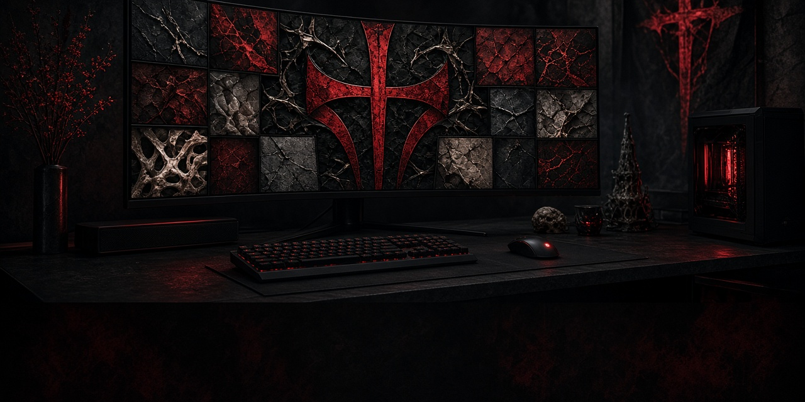

# cachyos-blackshield ⚫🛡

Blackshield Mercenary — the CachyOS theme pack. Black steel, blood-red cross
potent, EB Garamond type. The wave went to war.


For when the desktop should look like it's already won the fight.

## What's in the pack

| Area | Contents |
|---|---|
| **KDE Plasma** | `Blackshield` desktop theme, `Blackshield` aurorae window decorations, `Sweet Blackshield` look-and-feel, `Blackshield` color scheme, kdeglobals / kwinrc / ksplashrc |
| **Icons** | `Blackshield` icon theme — dark steel tiles, bone glyphs, one blood accent; hand-forged app icons (Firefox, Ghostty, Discord, Telegram, Steam, Lutris, Thunderbird) + medieval `hand-of-evil` cursor set |
| **Terminals** | Alacritty, Ghostty, kitty configs in full livery |
| **Shell** | Fish config — fastfetch greeting, nvim editor defaults (`configs/fish/config.fish`) |
| **Neovim** | `blackshield` colorscheme (`configs/nvim/colors/blackshield.lua`) |
| **Fastfetch** | Blackshield shield ASCII + config (`configs/fastfetch/`) |
| **Browsers** | Firefox userChrome/userContent + Chromium unpacked theme (`docs/BROWSERS.md`) |
| **Fonts** | EB Garamond, Pirata One, Xanh Mono, 3270 Nerd Font — shipped in-tree, installed to `~/.local/share/fonts` |
| **Boot & login** | Plymouth `blackshield` splash, Limine branding, Plasma login manager greeter config |
| **Wallpapers** | Primary/secondary/lock-login — 1080p + 1440p (`wallpapers/`) |
| **Extras** | OpenCode themes (`configs/opencode/themes/`), GTK settings, xsettingsd, hermes `blackshield` skin + knight pet art |

## Install

```bash
git clone https://github.com/synthalorian/cachyos-blackshield.git
cd cachyos-blackshield
./install.sh          # everything (configs + kde + fonts + wallpapers)
```

Run a single phase:

```bash
./install.sh packages   # pacman deps (alacritty, kitty, fish, fastfetch, nvim, ...)
./install.sh fonts      # ship bundled fonts to ~/.local/share/fonts
./install.sh configs    # terminals, shell, nvim, browsers, fastfetch, git template, opencode
./install.sh kde        # theme, decorations, look-and-feel, color scheme, global configs
./install.sh system     # sudo: Plymouth splash + Limine branding + login greeter
./install.sh wallpapers # copy + apply primary wallpaper
```

Requires: **CachyOS / Arch**, **KDE Plasma 6**. Backups of replaced user
configs are written next to each target as `*.blackshield.bak`.

## Palette

`#0B0D12` ember-black · `#8F959C` steel · `#C1121F` blood · `#D8D3C8` bone ·
`#E0555F` banner blood · `#242C3A` border iron

## Repo map

```
assets/           splash art
configs/          alacritty, browsers, fastfetch, fish, fonts, ghostty, git,
                  hermes (skin + pet), icons, kde, kitty, limine, nvim,
                  opencode themes, plymouth, system (login), xsettingsd
docs/             BROWSERS.md — browser theme install guide
manifest/         packages.txt — theme dependency package list
wallpapers/       blackshield + lock-login sets
install.sh        phase installer
```

## Blackshield theme family

- [blackshield-icon-pack](https://github.com/synthalorian/blackshield-icon-pack) — Android icon pack
- [blackshield-clock-widget](https://github.com/synthalorian/blackshield-clock-widget) — Android clock widget

---

Original work in this repo is MIT. Derived components keep their own licenses —
see [THIRD_PARTY_NOTICES.md](THIRD_PARTY_NOTICES.md).

**The shield holds.** ⚫🛡